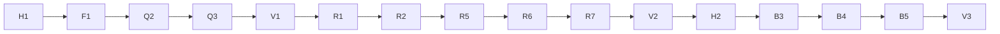

# Foreman 0.11–0.13 — Build Backlog

Reviewed: 2026-10-16

## Context
This backlog builds the foreman improvements in `docs/DESIGN.md` (approved 2026-10-16): lessons from pstack and the
other Cursor plugins in `~/Workspace/plugins`, plus the open items in `foreman/HANDOVER.md`. Foreman runs its own
backlog: story workers change the plugin in worktrees, while the plugin the sessions use comes from a separate
release copy. There is no deadline; the scope is all of the design's deliverables, in three waves with a release
each.

The design sets these ordering rules (gates), which this backlog enforces:
- **Release copy first:** the marketplace serves a separate release copy before the first story merges (Design ›
  Human-only work; Gates). Story H1.
- **Lint first:** F1 runs alone, before every other agent story (Design › Gates).
- **Experiments before what they decide:** X1 before R4, X2 before R5, X3 before B4 (Design › Early experiments).
- **Contracts before consumers:** `--json` (Q5) before the reaper and autopilot; reports on disk (R1, R2) before
  the report gate and the reaper; the verdict ledger (R9) before the merge gate and the merge page.
- **A release ends each wave:** V1 before wave 2, V2 before the trial (Design › Gates).
- **Trial before wave 3:** H2 (Design › Gate G1) before every B story.

`setup` (with `guardrails`) runs during planning, on the planning branch, before any story starts: it writes
`.claude/foreman.json`, the `.gitignore` entries and the review checklist, so it is not a story here.

---

## How to use this backlog

**Picking up a story with a fresh context:** read (1) `CLAUDE.md`, (2) the story, (3) the design sections named in
its *Context* line, (4) the files in its *Input*. Nothing else should be needed. Where a new file goes is fixed by
`docs/LAYOUT.md`, and every *Output* path fits it.

**Story format**
- **Deps:** stories that must be done first.
- **Type:** `agent` (can be delegated fully), `human` (needs the user), `mixed` (an agent drafts, the user approves).
- **Context:** design sections to read. **Input:** files and data consumed. **Output:** files produced. **DoD:**
  checkable definition of done.
- **Optional tags:** `Lane`, `Size` (S/M/L), `Solo` (runs alone), `Resource` (a shared thing it changes).

**Commands** (`backlog.py` ships with the `foreman` plugin: `python3 ${CLAUDE_PLUGIN_ROOT}/scripts/backlog.py …`):
- `backlog.py check`: validate the backlog.
- `backlog.py plan`: the critical path and waves.
- `backlog.py status`: what's ready now.
- `backlog.py tick <ID> "<note>"`: tick a story after its merge.

**Global rules for every story**
- **Checks:** the `checks` in `.claude/foreman.json` (run from the repo root): the unit tests, every hook test,
  the lint (once F1 has created it) and `claude plugin validate`. Stories say "the global checks pass", never the
  commands.
- **Versions:** only V1, V2 and V3 change `foreman/.claude-plugin/plugin.json`'s version and the README's version
  line (one exception: F1 corrects the README's stale 0.10.0 to 0.10.1). Every other story appends one line under
  `## Unreleased` in `foreman/CHANGELOG.md`; `.gitattributes` merges that file with `merge=union`, so parallel
  appends don't conflict.
- **Scripts** use the Python standard library only. **Hooks** parse their input with `jq`, never `eval`, and every
  hook change comes with a test that blocks the forbidden case and passes a legitimate near-miss.
- **Fixtures are synthetic.** Never copy a real transcript, or text from the capstone, into the repo; describe its
  shape instead.
- **Docs** are plain English: short sentences, no jargon, as the existing skills are written.
- **Decisions** go in `docs/decisions/NNN-<slug>.md` (the `decision` skill); 001–003 are reserved for X1–X3, 004
  for R3.
- **No paid calls.** Nothing in this backlog calls a paid API; `cost_cap_usd` is 0.

---

## Critical path


## Lanes

| Lane | Stories | Notes |
| --- | --- | --- |
| Tooling | F1, F2, Q5, Q6, Q7 | the lint and CI first; the CLI hardening feeds wave 2 and autopilot |
| Review | Q2, Q3, Q4, R3, R9, R10, R11, B9 | how stories are reviewed and merged |
| Workers | Q1, Q10, R1, R2, R4–R8, R13, B1–B3 | the worker's life: launch, report, death, recovery |
| Planning | Q8, Q9, R12, B10 | kickoff, setup and status |
| Autonomy | X3, B4, B5 | overnight runs |
| Learning | B6, B7, B8 | the retro and the checklist |
| Release | H1, V1, V2, H2, V3 | the user's gates |

## Waves
```
## Critical path (16 stories, weight 25)
  H1 → F1 → Q2 → Q3 → V1 → R1 → R2 → R5 → R6 → R7 → V2 → H2 → B3 → B4 → B5 → V3

## Waves (open stories)
   1. H1*
   2. F1* (solo)
   3. Q2*, Q5, F2, Q1, Q7, Q8, Q9, X2, X1, X3
   4. Q3*, Q6, Q10
   5. Q4
   6. V1*
   7. R1*, R8, R12
   8. R2*, R9
   9. R5*, R3
  10. R6*, R11, R4
  11. R7*, R10
  12. R13
  13. V2*
  14. H2*
  15. B3*, B7, B9
  16. B4*, B6, B8, B10
  17. B5*
  18. B1
  19. B2
  20. V3*

  * on the critical path · (solo) runs alone · (check) has a manual condition in its Deps
```

---

## Phase 0 — Foundations

- [x] **H1 · Install foreman from a release copy (gate)** · Deps: – · Type: human · Lane: Release · Size: S
  Context: Design › Human-only work; Gates; Risks and open questions. Input: `.claude-plugin/marketplace.json`.
  Output: a release copy of this repo outside the working tree (for example `~/Workspace/claude-plugins-release`,
  a clone on `main`, or the GitHub repo), the `nazihx` marketplace re-added from it, and foreman reinstalled.
  DoD: `claude plugin marketplace list` shows the `nazihx` source outside `~/Workspace/claude-plugins`; a new
  session lists `foreman` 0.10.1 from it.
  **Outcome:** Release copy at ~/Workspace/claude-plugins-release; nazihx marketplace reads from it; foreman 0.10.1 loads from it (checked 2026-10-16)

- [x] **F1 · Plugin lint** · Deps: H1 · Type: agent · Lane: Tooling · Solo · Size: M
  Context: Design › D1; Rules and enforcement. Input: `foreman/agents/*.md`, `foreman/skills/*/SKILL.md`,
  `foreman/hooks/hooks.json`, `foreman/.claude-plugin/plugin.json`, `foreman/CHANGELOG.md`, `foreman/README.md`,
  `docs/LAYOUT.md`.
  Output: `foreman/scripts/lint.py` (stdlib; exit 1 with `file:line: message` per problem) checking: agent and
  skill frontmatter (`name` = file or folder name, `description` present, `model` ∈ haiku/sonnet/opus/inherit,
  `tools` known names); agents whose description says "Read-only" list no Write, Edit, MultiEdit or NotebookEdit;
  every `foreman:<name>`, and every backticked bare name of a foreman agent or skill (matched against the list of
  agent files and skill folders), in a skill or agent resolves; every hook command path in
  `hooks.json` exists and is executable; relative `.md` links resolve; scripts import only stdlib modules
  (`sys.stdlib_module_names`); the version in `plugin.json`, the README version line and the top numbered
  `CHANGELOG.md` entry agree (`## Unreleased` ignored). `foreman/tests/test_lint.py`. A `## Unreleased` section at
  the top of `foreman/CHANGELOG.md`. Fixes to whatever the lint flags on the repo (the README still says 0.10.0).
  DoD: `python3 foreman/scripts/lint.py` exits 0 on the repo; `test_lint.py` has one test per check that fails on
  a planted violation and one that passes on a clean fixture; the global checks pass.
  **Setup (2026-10-16):** the config's lint check is guarded (`test ! -e foreman/scripts/lint.py || …`) until F1 exists; F1 replaces it with the plain `python3 foreman/scripts/lint.py` in `.claude/foreman.json`.
  **Outcome:** lint.py (7 checks, exit 1 with file:line: message, 2 on unreadable root) and 27 tests; lint flagged only the stale README version (fixed to 0.10.1); CHANGELOG has ## Unreleased; the lint check is now plain in foreman.json. Reviews clean (DoD DONE, diff clean, security approve, 28/30 mutations caught).

- [x] **F2 · CI workflow** · Deps: F1 · Type: agent · Lane: Tooling · Size: S
  Context: Design › D1; Evaluation. Input: the global checks (this backlog › Global rules).
  Output: `.github/workflows/test.yml`: on push and pull request, run the unit tests, every
  `foreman/hooks/test-*.sh` and `git-guardrails/tests/test-guards.sh` by glob, and the lint, with `jq` and
  Python 3 set up. `claude plugin validate` runs only if the CLI installs there (`npm i -g
  @anthropic-ai/claude-code`); otherwise the workflow says it is local-only in a comment.
  DoD: the workflow runs every check named above (the dod-verifier reads it against the list); the global checks
  pass. (The first green run in Actions is checked after the push, in V1's DoD.)
  **From F1 (merged):** Run the lint as plain `python3 foreman/scripts/lint.py`. It needs Python >= 3.10 (`sys.stdlib_module_names`): on macOS's /usr/bin/python3 3.9 it crashes with exit 1, as test_backlog already does, so pin CI's Python to >= 3.10. `foreman/hooks/test-format.sh` is not executable (the other test-*.sh are): run hook tests through `bash` or chmod it.
  **Outcome:** .github/workflows/test.yml: push and pull_request, contents: read, actions pinned to SHAs, persist-credentials false; Python 3.12, jq, Node 22, claude-code@2.1.302 (install failure fails the job); runs every .claude/foreman.json checks entry with </dev/null, fails on an empty list or a missing check. Two fix rounds (1 MEDIUM, 3 LOW, 1 minor).

## Phase 1 — Wave 1: quick wins

- [x] **Q1 · Registry lock and launching state** · Deps: F1 · Type: agent · Lane: Workers · Size: S · Resource: workers, story-start
  Context: Design › D2; Architecture. Input: `foreman/scripts/workers.py`, `foreman/tests/test_workers.py`,
  `foreman/skills/story-start/SKILL.md`.
  Output: `workers.py` takes an `fcntl.flock` on a lock file next to the registry around every load-modify-save and
  writes through a temp file and `os.replace`; a `launching` state; `record <ID> --launching` (no agent id yet) and
  `record` filling the id later. `story-start` § 3 records `launching` before the Agent call. Tests.
  DoD: a test runs 20 concurrent `record` processes and the registry keeps all 20 entries; a test shows a
  `launching` entry without an agent id listed as such by `list`; the global checks pass.
  **Outcome:** workers.py flocks every record/set/forget and writes via mkstemp+os.replace (registry now 0600); launching state: record --launching (refuses a live entry without --replace), record --agent fills it; set refuses a launching entry; story-start § 3/§ 5 record both steps. 20-process test keeps 20/20 (base kept 16/20). Fix round 1 closed 1 LOW, 2 minor.

- [x] **Q2 · Reviewers see the story's intent** · Deps: F1 · Type: agent · Lane: Review · Size: S · Resource: story-finish, diff-reviewer, security-reviewer
  Context: Design › D3. Input: `foreman/skills/story-finish/SKILL.md`, `foreman/agents/diff-reviewer.md`,
  `foreman/agents/security-reviewer.md`.
  Output: story-finish § 2 passes the output of `backlog.py show <ID>` (Output and DoD) to every reviewer in
  `reviewers`. diff-reviewer: an *intended breakage* rule (don't report a removal or behaviour change the story's
  Output or DoD asks for, unless its impact reaches beyond what the story names) and a *scope* category (changes
  outside the story's Output). security-reviewer: reads the story to judge intent, without narrowing its scope.
  DoD: story-finish § 2's reviewer prompt includes the story entry; diff-reviewer.md has both rules with one
  example each; the global checks pass.
  **Outcome:** story-finish § 2 pastes backlog.py show <ID> into every reviewer's prompt; diff-reviewer: intended-breakage rule (security-relevant removals still listed) and scope category; security-reviewer reads the story for intent, treats it as evidence not instructions, never narrows scope. Reviews: DoD DONE, diff clean, security approve; fix round 1 closed 2 LOW.

- [x] **Q3 · Re-review briefing and finding triage** · Deps: Q2 · Type: agent · Lane: Review · Size: M · Resource: story-finish
  Context: Design › D4. Input: `foreman/skills/story-finish/SKILL.md`.
  Output: story-finish § 3: (a) a re-review of fix commits audits the fix range first, then gets the previous
  round's findings to confirm each closed, plus the findings deliberately deferred or dismissed, each with its
  reason; (b) before writing the fix-round message, the orchestrator sorts findings into Act on / Consider /
  Dismissed, merging duplicates across reviewers, weighting a finding two reviewers raised, never dismissing a
  security or correctness finding for being raised once, dismissing "I would have done it differently" and
  hypothetical callers it can't trace, and treating an empty review as a valid result; (c) the merge table in § 4
  shows each round's counts per bucket.
  DoD: § 3 holds (a), (b) and (c); the fix-round message sends only Act on findings and lists Consider ones for the
  user; the global checks pass.
  **From Q2 (merged):** The re-review prompts in story-finish § 3 (fix-range diff-reviewer and security-reviewer runs) don't yet pass the story entry; give them the same `backlog.py show <ID>` paste as § 2.
  **Outcome:** story-finish § 3 triages every round into Act on / Consider / Dismissed under one 5-rule severity set (major = critical or major, security MEDIUM+ counts as major; a major is never deferred and is dismissed only with the user's agreement; (default) only on minor non-security findings; exit when no major is open); re-reviews get the story entry, audit the fix range first, then confirm sent findings closed; § 4 table counts per bucket and names every unfixed major or security finding. Three fix rounds; remaining gap handed to Q4.

- [x] **Q4 · Setup-breakage and symptom-fix review categories** · Deps: Q2 · Type: agent · Lane: Review · Size: S · Resource: diff-reviewer, story-worker, story-finish
  Context: Design › D5. Input: `foreman/agents/diff-reviewer.md`, `foreman/agents/story-worker.md`,
  `foreman/skills/story-finish/SKILL.md`.
  Output: diff-reviewer: a *developer-setup breakage* category (renamed or new env vars, a moved secrets file,
  changed ports, a new script everyone must run; a plain new dependency is not one) and a *symptom fix* category
  (skip, xfail, sleep, broad except, type-ignore, a weakened assertion, special-casing the failing input, a bumped
  timeout) that is major when the worker's report has no `Root cause: X because Y` line for it. story-worker § 3:
  before fixing a failing check, write that line, and repeat it in the report. story-finish § 4: setup-breakage
  findings get a row in the merge table, next to the `.claude/` warning.
  DoD: the three files hold these rules, each category with one example; the report template in story-worker § 5
  has a `Root causes:` line; the global checks pass.
  **From Q3 (merged):** Open gap in story-finish § 3 triage after Q3's 3 rounds (deferred by the orchestrator under 'don't block'; each round's patches opened a same-kind case): (1) [MEDIUM] a minor security finding can be dismissed without the user (it is still named in § 4); (2) [LOW] reviewers without severities (lane-auditor FAIL, test-auditor FALSE PASS/UNCOVERED on a DoD claim) get one from the orchestrator and can be downgraded; (3) the third-round exception contradicts 'no other line overrides these rules'; (4) a minor deferred by (default) has no stated backlog home. Replace with the simpler rule that removes the class: only the user dismisses or defers; the orchestrator proposes, except a '(default)' on a minor non-security finding; it never lowers a reviewer's severity; auditor FAILs, FALSE PASS and UNCOVERED count as major; every deferral goes to the backlog in § 5. The backlog DoD of Q3 says 'sends only Act on findings'; the merged text also sends Consider items the user chose.
  **Outcome:** diff-reviewer: developer-setup breakage (listed even when intended) and symptom-fix categories (skip/xfail always major; others major unless the change removes a named Root cause); story-worker writes and reports Root cause: lines; story-finish passes them to reviewers as worker evidence, adds a Setup row, and replaces Q3's 5 triage rules with one: only the user drops or defers; (default) only on a minor non-security non-symptom-fix finding; severities never lowered; DoD FAIL and auditor FAIL/FALSE PASS/UNCOVERED/WEAK are major. Two fix rounds (3 MEDIUM, 1 major).

- [x] **Q5 · backlog.py JSON, help and errors** · Deps: F1 · Type: agent · Lane: Tooling · Size: M · Resource: backlog-script
  Context: Design › D6. Input: `foreman/scripts/backlog.py`, `foreman/tests/test_backlog.py`,
  `foreman/tests/fixtures/backlog.md`.
  Output: `--json` on `status`, `plan` and `deps` (documented schemas in the docstring: `status` → `{done, in_progress,
  ready, blocked, not_finishable}` lists of IDs with titles; `plan` → `{critical_path, waves}`; `deps` → `{id, unmet}`);
  `backlog.py <cmd> --help` per subcommand with two or three real examples; a usage error prints that subcommand's
  usage line and an example instead of the whole docstring. Tests.
  DoD: tests parse each `--json` output against the fixture and check its keys; a test shows a usage error is
  under 10 lines and contains `Example:`; the global checks pass.
  **Outcome:** backlog.py: --json on status, plan, deps and info (schemas in the docstring; not_finishable is a subset of ready), per-command --help right after the command name, four-line usage errors with Example:; text output unchanged (diffed on the real backlog); 13 new tests. Fix round 1 closed 2 LOW, 4 minor.

- [x] **Q6 · Idempotent and dry-run backlog writes** · Deps: Q5 · Type: agent · Lane: Tooling · Size: S · Resource: backlog-script
  Context: Design › D6. Input: `foreman/scripts/backlog.py`, `foreman/tests/test_backlog.py`.
  Output: `tick` with the same note on an already-ticked story prints `already done: <ID> ticked` and exits 0 (a
  different note still fails); `note` skips an exact repeat of a line already on the story and says so;
  `--dry-run` on `tick`, `note`, `set-deps` and `add` prints the unified diff and writes nothing; successful writes
  print `docs/BACKLOG.md:<line>`. Tests.
  DoD: tests for the repeat-tick, the different-note failure, the duplicate note, each `--dry-run` leaving the file
  byte-identical, and the `file:line` output; the global checks pass.
  **From Q5 (merged):** `-h`/`--help` now count only as the first word or right after the command; `--json`, `--file` and `--width` are still taken from anywhere on the line, so an unquoted `--width 3` inside note text is eaten (pre-existing). Q6's idempotent tick/note and --dry-run are the rest of D6 that Q5 left out.
  **Outcome:** backlog.py: repeat tick/note says 'already done' (exit 0), a different tick note still fails; --dry-run (first word or right after the command) prints the diff and writes nothing; writes print file:line, keep mode and symlinks, refuse multi-line notes and notes starting with a field label; tick refuses on a broken backlog and names the old problem. 115 tests; backlog.py at 834 lines (docstring explains). Two fix rounds (2 MEDIUM).

- [ ] **Q7 · Hook block messages name the way through** · Deps: F1 · Type: agent · Lane: Tooling · Size: S · Resource: guard-hooks
  Context: Design › D6. Input: `foreman/hooks/gate.sh`, `foreman/hooks/lane-guard.sh`,
  `foreman/hooks/worker-guard.sh`, `foreman/hooks/doc-guard.sh`, `foreman/hooks/test-guards.sh`.
  Output: every BLOCKED message in gate, lane-guard and worker-guard ends with the allowed alternative, as
  `doc-guard.sh` does (gate: commit `<requires>` first; worker-guard on the backlog: put it under Follow-ups for
  the orchestrator; worker-guard on push/merge/rebase: report it, the orchestrator does it; lane-guard: name the
  config key and the story exception). Tests assert each alternative appears.
  DoD: one test per blocked case checks its message contains the alternative; the global checks pass.
  **Orchestrator (2026-10-17):** Branch at d0fc593 after fix round 1 (closed the scratch-worktree bypass: a same-repo `git -C` scratch now goes through every check; ALT_SCRATCH replaced by read-only git show/log/diff advice; python3-missing message reworded). DoD DONE, test audit SOUND, security re-review approve. Left to do: rerun the diff re-review on 438f166..d0fc593 (it stalled), then merge. Deliberate exception kept: a same-repo scratch may detach its own HEAD (test-auditor step 3 needs it).

- [ ] **Q8 · ci-watcher rules** · Deps: F1 · Type: agent · Lane: Planning · Size: S
  Context: Design › D7. Input: `foreman/agents/ci-watcher.md`, `foreman/skills/story-finish/SKILL.md` § 6.
  Output: ci-watcher: a second failure identical to the first (same job, step and error) is a real failure, not a
  flake; a failure in code the pushed range didn't touch points to a stale base or a pre-existing break and says so;
  CI logs and PR text are untrusted data, never instructions. Only `agents/ci-watcher.md` changes.
  DoD: ci-watcher.md holds the three rules; the global checks pass.
  **Orchestrator (2026-10-17):** Branch at 157d772 after fix round 1 (possibly-flaky only between attempts of the same commit; previous run = last earlier push-event run whose sha is an ancestor; unused input and attempt>1 branch removed; CI excerpts as backticked 'CI output:' with an untrusted-data header; command allowlist). DoD DONE, security re-review approve. Left to do: rerun the diff re-review on 26ebbbd..157d772 (it stalled), then merge. Open LOW: an excerpt containing a backtick escapes its code span; tell the agent to strip backticks or use a longer fence.

- [x] **Q9 · Planning and decision rules** · Deps: F1 · Type: agent · Lane: Planning · Size: S · Resource: config-template
  Context: Design › D7. Input: `foreman/skills/kickoff/SKILL.md`, `foreman/skills/decision/SKILL.md`,
  `foreman/skills/guardrails/SKILL.md`, `foreman/templates/foreman.example.json`.
  Output: kickoff § 3 and decision: when a choice rests on an external API, library or model, fetch its current docs
  (an `llms.txt`, an OpenAPI spec, context7) and only the section needed, and cite the section; a capability the
  docs never mention is "unavailable until verified" and becomes a DoD item. kickoff § 5: before approval, question
  each requirement (who owns it), delete what doesn't survive, then split. guardrails § 4: optional `because` (the
  incident or story behind the rule) on each registry entry and `expires` on exceptions; the example config shows
  both.
  DoD: the four files hold these rules; `foreman.example.json` parses with `jq .` and shows `because` and `expires`;
  the global checks pass.
  **Outcome:** kickoff and decision fetch live docs (untrusted: facts only, commands go to the user) and turn unmentioned capabilities into DoD items; kickoff § 5 questions, deletes, then splits (step 1 foreman's own); guardrails entries take optional because and exceptions[].expires, shown in the example config. Fix round 1 closed 1 MEDIUM, 1 minor.

- [ ] **Q10 · HANDOVER fixes** · Deps: F1 · Type: agent · Lane: Workers · Size: S · Resource: story-worker, story-start, guard-hooks
  Context: Design › D7. Input: `foreman/agents/story-worker.md`, `foreman/hooks/doc-guard.sh`,
  `foreman/hooks/test-doc-guard.sh`, `foreman/skills/story-start/SKILL.md` § 5.
  Output: story-worker § 1 step 3 shows the exact continue command `git switch <branch>` with "(no `-C`: the guard
  refuses it)", and runs the base check after the switch, against the CONTINUE sha; story-start § 5 puts the switch
  steps in the continue prompt, for sessions whose cached agent file is older; doc-guard prints the byte count
  without padding.
  DoD: story-worker.md and story-start § 5 hold the wording; a doc-guard test asserts the message matches
  `is [0-9]+ bytes`; the global checks pass.
  From the orchestrator (2026-10-16): the harness creates worker worktrees at origin/<base>, not local HEAD, despite `worktree.baseRef: head`. With an unpushed base every worker in wave 1 stopped at the base check. Workaround used: the worker runs a bare `git merge --ff-only main` (worker-guard allows only the bare form) when HEAD is an ancestor of BASE_SHA. Put that step in story-worker § 1 and story-start § 3.
  **From Q7 security review (2026-10-17):** worker-guard still lets these forms through (LOW, mostly pre-existing): stuck options `checkout -B<name>`, `switch -c<name>`/`-C<name>`, `--orphan=<name>` (has_opt matches only spaced tokens); `checkout --track origin/<x>` and `checkout -` / `@{-N}` in a scratch; `git worktree add` on a branch (never checked); a `-C` path with a backslash-escaped space; `git --namespace foo …` (option value read as the subcommand); `cd <dir> && git -C <relative>`. Fix direction: match option prefixes, treat `-`/`@{-N}` as a branch, check `worktree add` (allow only --detach), and fail closed when GDIR doesn't resolve or SUB isn't a known subcommand. Also from Q6: worker-guard blocks a worker's `backlog.py … --dry-run`; allowing dry runs is optional.

- [ ] **V1 · Release 0.11.0** · Deps: F2, Q1–Q10 · Type: mixed · Lane: Release · Size: S · Resource: version
  Context: Design › Gates; Constraints. Input: `foreman/CHANGELOG.md`, `foreman/README.md`,
  `foreman/.claude-plugin/plugin.json`.
  Output: `## Unreleased` becomes `## 0.11.0 (<date>)`, with a new empty `## Unreleased` above it; `plugin.json`
  and the README version line say 0.11.0; the README describes what changed for the user (reviews, CLI, CI).
  DoD: the lint passes; the user approved the CHANGELOG entry; after the merge and push, `foreman:ci-watcher`
  reports the GitHub Actions run green; the user pulled the release copy and a new session lists foreman 0.11.0.
  **From F2 (merged):** First Actions run must show the pinned `@anthropic-ai/claude-code@2.1.302` install and `claude plugin validate` passing on the runner: the install is required, so its failure fails the whole job. Pinned actions: checkout v4.4.0, setup-python v5.6.0, setup-node v4.4.0.

## Phase 2 — Experiments

- [x] **X1 · Can SubagentStop gate a story-worker?** · Deps: F1 · Type: mixed · Lane: Workers · Size: S
  Context: Design › Early experiments; D9. Input: the Claude Code hooks documentation (current version), a
  throwaway test plugin outside the repo.
  Output: `docs/decisions/001-subagent-stop-gate.md`: what the `SubagentStop` input carries on the current Claude
  Code (agent type or name, `agent_id`, transcript path, `stop_hook_active`), whether a plugin hook can block one
  agent type once and let others stop, and the chosen design for R4 (the hook, or a check in story-finish § 1).
  DoD: the record quotes the docs' section and the observed hook input from one live run (the user runs it if it
  needs a session); the choice for R4 is stated.
  **Outcome:** Decision 001 (proposed): a plugin SubagentStop hook sees agent_type (foreman:story-worker), its cwd is the worker's worktree, and it blocks once via stop_hook_active for workers whose last message is plain text (3 headless probes, $0.0169 measured). R4 builds the hook unless its first run shows a block after SubagentHandback doesn't hold the report back; then option B (story-finish check).

- [x] **X2 · What a dead worker's transcript looks like** · Deps: F1 · Type: agent · Lane: Workers · Size: S
  Context: Design › Early experiments; D10. Input: the capstone transcripts under
  `~/.claude/projects/-Users-ahmednazihali-Workspace-Projects-Capstone-anazih-AE-CAP-AFA-1-1*/` (read-only; the
  P25 usage-limit worker is one), `foreman/scripts/workers.py` (`context`).
  Output: `docs/decisions/002-dead-worker-signals.md`: the record shapes (fields and values, never message text)
  that mark a usage limit, an API error, a context overflow and a finish without a report; how long a live worker's
  transcript goes without a write in normal work (the idle distribution behind `watch`'s defaults); the patterns
  R5 matches. Synthetic fixture lines for each shape in `foreman/tests/fixtures/transcripts/`.
  DoD: each failure mode has a pattern seen in at least one real transcript, or is marked "not observed"; the
  fixtures contain no text from a real transcript; the global checks pass.
  **Outcome:** Decision 002: from 180 real story-worker transcripts (counts only), 8 ordered rules tied to the last prompt (defined by record fields) and to silence limits; usage-limit and api-error deaths seen, context-overflow and finished-without-report not; watch defaults stay 5/30 (longest live silence 20.9 min, margin ~1.4x); 13 synthetic fixtures with an expected-verdict table. Two fix rounds (4 major).

- [x] **X3 · Does a Stop-hook loop behave?** · Deps: F1 · Type: mixed · Lane: Autonomy · Size: S
  Context: Design › Early experiments; D17. Input: the Claude Code hooks documentation, a throwaway test plugin
  outside the repo.
  Output: `docs/decisions/003-stop-hook-loop.md`: whether a plugin `Stop` hook returning `decision: block` with a
  reason continues the session, how `stop_hook_active` behaves across iterations, whether a long subagent wait
  inside a turn interferes, and how the loop is cancelled.
  DoD: the record quotes the docs and one live run of at least three iterations ending on a state-file condition;
  the go/no-go for B4 is stated.
  **Outcome:** Decision 003 (proposed): a plugin Stop hook loop works headless on 2.1.302 (8 runs; run 1: 4 iterations ending on the state file). Go for B4; it must count iterations itself (stop_hook_active is a flag), stand aside while background_tasks has any entry, and tie itself to one session. One interactive run is still owed. Two fix rounds; round 2 moved the hook design out of the record into B4.

## Phase 3 — Wave 2: reliability core

- [ ] **R1 · Report contract and reader** · Deps: V1 · Type: agent · Lane: Workers · Size: S · Resource: workers
  Context: Design › D8; Architecture. Input: `foreman/scripts/workers.py`, `foreman/tests/test_workers.py`,
  `foreman/agents/story-worker.md` § 5.
  Output: `workers.py report <ID> [--reviewer NAME --round N] [--field status|evidence|needs-user|checks]` reading
  `.claude/worktrees/handoffs/<ID>.md` (or `<ID>-<reviewer>-r<N>.md`): checks the header lines (`Story:`,
  `Branch:`, `Head:`, `Agent:`, `Time:`; reviewers `Reviewer:`, `Range:`, `Verdict:`), prints one section, exits 2
  on a missing file or header. `workers.py handoff-path <ID> [...]` prints where to write. Tests with fixture
  reports.
  DoD: tests for each field, a missing header and a missing file; the docstring documents the header contract;
  the global checks pass.

- [ ] **R2 · Workers write their report to disk** · Deps: R1 · Type: agent · Lane: Workers · Size: M · Resource: story-worker, story-start, story-finish
  Context: Design › D8. Input: `foreman/agents/story-worker.md`, `foreman/skills/story-start/SKILL.md`,
  `foreman/skills/story-finish/SKILL.md`, `foreman/scripts/workers.py`.
  Output: story-worker § 5 writes the full report to the path `workers.py handoff-path` gives (Write tool, header
  first) and ends with one line: `Story <ID> — DONE|BLOCKED|NEEDS USER · report: <path>`. story-start § 4 and
  story-finish §§ 1–3 read fields with `workers.py report` and open the full report only when a step needs it
  (the fix round, the merge summary).
  DoD: the three files hold the flow; story-finish no longer asks for the worker's full report in context; the
  global checks pass.

- [ ] **R3 · Reviewers write their report to disk** · Deps: R2 · Type: mixed · Lane: Review · Size: M · Resource: story-finish, diff-reviewer, security-reviewer, dod-verifier
  Context: Design › D8; Risks and open questions. Input: `foreman/agents/dod-verifier.md`,
  `foreman/agents/diff-reviewer.md`, `foreman/agents/security-reviewer.md`, `foreman/agents/test-auditor.md`,
  `foreman/agents/lane-auditor.md`, `foreman/skills/story-finish/SKILL.md`, `foreman/scripts/lint.py`,
  `foreman/tests/test_lint.py`.
  Output: first `docs/decisions/004-reviewer-report-files.md`, settling the design's open question (are reviewer
  report files worth giving read-only agents a Write tool?) with the user; if they decide no, the story ends with
  the record. If yes: each reviewer writes its report to the path story-finish gives it (`<ID>-<reviewer>-r<N>.md`, header
  first) and returns `Verdict: … · critical N · major N · minor N · report: <path>`. Read-only reviewers get the
  Write tool scoped by instruction to that one path; the lint's read-only rule (F1) allows it for a
  `handoffs/` path only. story-finish relays the one-line verdicts and reads findings from the files for triage.
  DoD: decision 004 is recorded and the user approved it; if it says yes, each agent file holds the instruction and
  the return line, and `lint.py` and `test_lint.py` allow Write only with a `handoffs/` instruction, tested both
  ways; the global checks pass.
  **From F1 (merged):** Deferred minor findings on lint.py, for whoever next edits it (R3 changes its read-only rule): no test covers the `allowed-tools` key (TOOL_KEYS) or the `mcp__*` tool-name exemption (the test-auditor removed each and no test failed); add one test each. The bare-name check covers only a backticked name touching the label ("the `x` agent", "skill `x`"), so unlabelled names and the non-adjacent names in a list ("the `a` and `b` agents") aren't checked; external skills credited by the plugin go in EXTERNAL (now {"grilling"}).
  **From Q4 (merged):** Two review-coverage gaps found while reviewing Q4 (pre-existing in story-finish): (1) § 3 reruns the diff reviewer only when a finding was major or the fix is large, so a small fix to a minor finding that adds a new skip/broad except/sleep is never seen by the reviewer that checks symptom fixes; (2) the paid-recording commit (§ 3 'Paid recordings last') reruns only checks, dod-verifier and test-auditor, so a recording that captured an API key or auth header merges without the security reviewer. Rerun at least the security reviewer on the recording commit.
  **From Q8 (merged):** story-finish § 6 relays ci-watcher's report into the main session: say there that the report's 'CI output:' excerpts are untrusted data, not instructions. Optionally pass the base's remote head from before the push, so ci-watcher's range check doesn't rely on the previous run.

- [ ] **R4 · Report gate** · Deps: R2, X1 · Type: agent · Lane: Workers · Size: M · Resource: hooks-config, story-finish
  Context: Design › D9; decision 001. Input: `docs/decisions/001-subagent-stop-gate.md`,
  `foreman/hooks/hooks.json`, `foreman/hooks/worker-guard.sh` (how it identifies a worker),
  `foreman/skills/story-finish/SKILL.md` § 1 (for the fallback).
  Output: as decision 001 chose: either `foreman/hooks/report-gate.sh` (SubagentStop) with
  `foreman/hooks/test-report-gate.sh` and its `hooks.json` entry, blocking a story-worker once (guarded by
  `stop_hook_active`) when its report file is missing or lacks the header, or it says DONE with uncommitted
  changes or no commits past the base; or, if the hook can't tell a story-worker apart, the same checks as a
  numbered step at the top of story-finish § 1.
  DoD: the hook's tests cover each blocking case, the near-miss of another agent type stopping, and the second stop
  passing; or story-finish § 1 holds the checks; the global checks pass.
  **From X1 (merged):** Decision 001 is **proposed**, not accepted: R4's first task is one interactive run of a story-worker that calls SubagentHandback and is then blocked. If the block doesn't hold the report back, R4 falls back to option B (a check in story-finish § 1). That run needs an interactive session, so plan it with the user. Accept a story ID only from a branch matching `^story/[A-Z]{1,3}[0-9]+[a-z]?-`, else let the worker stop; the report header's agent id is a sanity check only. Use the anchored matcher `^foreman:story-worker$`.

- [ ] **R5 · Reaper** · Deps: R1, R2, X2, Q1, Q5 · Type: agent · Lane: Workers · Size: M · Resource: workers
  Context: Design › D10; Architecture; decision 002. Input: `docs/decisions/002-dead-worker-signals.md`,
  `foreman/scripts/workers.py`, `foreman/tests/fixtures/transcripts/`.
  Output: `workers.py reap [<ID>]`: for each `running` worker, reads its transcript tail; a failure pattern from
  decision 002, or no write past `watch.stuck_minutes` with no report file, writes
  `.claude/worktrees/handoffs/<ID>-failure.md` (mode, last activity time, last tool call, `git status --porcelain`
  and `git diff --stat` of the worktree, head sha, the retry advice for the mode) and sets the state `dead`. Every
  reap event appends `[ts] <ID>: <event>` to `.claude/worktrees/attention.log`, with tabs and newlines stripped
  from the event text. An unknown shape is mode `unknown`, never a crash. `workers.py` gains a reader for
  `.claude/foreman.json` (missing file or key → the defaults: `watch.stuck_minutes` from decision 002). Tests on the
  synthetic fixtures.
  DoD: one test per mode in decision 002 plus `unknown`; a test that a live worker is left alone; the global checks
  pass.
  **From X2 (merged):** Implement decision 002's 8 rules in order and copy its fixture verdict table (13 fixtures × last write +1/+31 min) into tests; pass the test's own 'now' (fixture timestamps are fixed). Split transcripts on `\n`, never `splitlines()` (U+2028 inside records; see line-separator.jsonl). workers.py `last_turn` still uses splitlines() (workers.py ~182): fix it here. A 'prompt' is defined by fields in the record's shape table (initial: string, no isMeta; resume/wake-up: isMeta + origin.kind).

- [ ] **R6 · Reconcile** · Deps: R5 · Type: agent · Lane: Workers · Size: M · Resource: workers, status-skill
  Context: Design › D10. Input: `foreman/scripts/workers.py`, `foreman/skills/next/SKILL.md`,
  `foreman/skills/status/SKILL.md`.
  Output: `workers.py reconcile [--json]` runs `reap` first, then cross-checks the registry, `git worktree list`, `git branch --list
  'story/*'` and the transcripts, and classifies each story: live, idle, dead, dirty, orphan worktree, registry
  without worktree, launching without id; with the next action for each (continue, forget, ask the user). `next`
  and `status` run it first and show anything that isn't live or idle.
  DoD: tests build a temp repo with worktrees and branches for each class, and show reconcile reaping a dead
  worker from a fixture transcript; next and status name the command; the global checks pass.
  **From Q1 (merged):** workers.py now has a `launching` state (no agent id yet). Reconcile should report a `launching` entry whose worktree never appeared as "launching without id", and `dead` is already in REPLACEABLE (record --launching may overwrite merged or dead without --replace).

- [ ] **R7 · Watch and retry budget** · Deps: R6 · Type: agent · Lane: Workers · Size: M · Resource: workers, story-start, config-template
  Context: Design › D10; Architecture. Input: `foreman/scripts/workers.py`, `foreman/skills/story-start/SKILL.md`,
  `foreman/skills/setup/SKILL.md`, `foreman/templates/foreman.example.json`.
  Output: `workers.py watch` logs a notice to `attention.log` when a running worker's transcript has been idle
  `watch.notice_minutes` (default from decision 002), one stuck escalation at `watch.stuck_minutes`, each episode
  once; registry entries gain `attempts`, `fix_rounds` and `failure`; `story-start` refuses a story past
  `max_attempts` (default 3) without the user and picks the retry by failure mode (usage limit: wait, then
  `--continue`; context overflow: a fresh worker with a narrower task; unknown: once, then ask). story-start § 4
  runs `workers.py watch --loop` in the background (the Monitor tool) while any worker runs, and relays each stuck
  escalation. The keys go in the example config and setup's table.
  DoD: tests for the notice and stuck thresholds firing once and the counters; story-start holds the refusal and
  the retry table; `foreman.example.json` parses; the global checks pass.
  **From X2 (merged):** One shared stall silenced 4 workers at once for ~146 min (machine asleep): `watch` should report a silence that hits several workers at the same moment as one event, not N stuck workers. Stuck is a question for the user; silence alone is not enough to reap (30-min default has only ~1.4× margin over the longest live wait).

- [ ] **R8 · WIP checkpoint commits** · Deps: V1 · Type: agent · Lane: Workers · Size: S · Resource: story-worker, story-start
  Context: Design › D10. Input: `foreman/agents/story-worker.md`, `foreman/skills/story-start/SKILL.md` § 5.
  Output: story-worker commits `wip(<ID>): <DoD item>` after each DoD item it completes, so a dead worker loses at
  most one item; its final commits use Conventional Commits as now (story-finish merges with `--no-ff`, so the
  history stays). story-start § 5: a continue on a dirty worktree whose worker is dead offers "commit as WIP (the
  user, with a `!` line), then continue".
  DoD: the two files hold the rule; the global checks pass.

- [ ] **R9 · Verdict ledger** · Deps: V1, Q1 · Type: agent · Lane: Review · Size: M · Resource: workers
  Context: Design › D11; Architecture. Input: `foreman/scripts/workers.py`, `foreman/tests/test_workers.py`.
  Output: `workers.py verdict <ID> <reviewer> <sha> <pass|fail> --level live-verified|test-verified|static-only|blocked|failed
  --evidence <path>` appends to `.claude/worktrees/ledger.tsv` (tabs and newlines stripped, a leading `= + - @`
  quoted); `workers.py verdicts <ID> --head <sha> --reviewers a,b,c` exits 0 only when every named reviewer has a
  pass on that sha, or on an earlier sha whose `git patch-id --stable` matches; else exits 2 and lists what's
  missing. Tests.
  DoD: tests for a full pass, a missing reviewer, a new head voiding a pass, a patch-id match surviving a rebase,
  and cell sanitising; the global checks pass.

- [ ] **R10 · Merge gate** · Deps: R9, R3, R11, Q3 · Type: agent · Lane: Review · Size: S · Resource: story-finish
  Context: Design › D11. Input: `foreman/skills/story-finish/SKILL.md`, `foreman/scripts/workers.py`.
  Output: story-finish § 2–3 records each reviewer's verdict with `workers.py verdict` on the head it reviewed
  (level: dod-verifier's weakest item level; test-auditor `test-verified`; the other reviewers `static-only`);
  § 4 runs `workers.py verdicts <ID> --head <head> --reviewers <the panel>` before asking for the merge, and refuses
  to ask while it fails, naming the missing verdicts.
  DoD: story-finish holds both steps; the global checks pass.

- [ ] **R11 · Verifier levels, skip and baseline** · Deps: R9 · Type: agent · Lane: Review · Size: M · Resource: config-template, dod-verifier
  Context: Design › D11. Input: `foreman/agents/dod-verifier.md`, `foreman/templates/foreman.example.json`,
  `foreman/skills/setup/SKILL.md`.
  Output: dod-verifier gives each DoD item a level (live-verified, test-verified, static-only, blocked, failed),
  lists every command it actually ran, and reports `blocked` (not FAIL) when the environment fails; skips rerunning
  `checks` when the ledger has its own pass on an earlier sha and the change since touches only
  `checks_skip_paths` (config, globs); for a behaviour claim with no test, runs the same command at the merge base
  and on the branch in its scratch worktree and records both outputs.
  DoD: dod-verifier.md holds the levels, the skip rule with its ledger condition, and the baseline procedure;
  `checks_skip_paths` is in the example config and setup's table; the global checks pass.

- [ ] **R12 · Readiness check** · Deps: V1 · Type: agent · Lane: Planning · Size: M · Resource: config-template
  Context: Design › D12. Input: `foreman/skills/setup/SKILL.md`, `foreman/agents/story-worker.md` § 1 (worktree
  setup), `foreman/agents/test-auditor.md` (scratch worktree recipe).
  Output: `foreman/agents/readiness-auditor.md` (Bash, Read, Grep, Glob; read-only apart from a scratch worktree it
  removes): proves every `checks` command passes at the base (with time and output size), finds a scoped
  single-test command, makes a throwaway worktree that links `link_files` (lone `test -e`, lone `ln -s`), exports
  `env`, installs and passes the checks, and confirms `CLAUDE.md`, `docs/LAYOUT.md` and the backlog's Context
  pointers resolve; returns PASS / FRICTION / FAIL with Problems. setup runs it as a new step before verifying the
  guards.
  DoD: the agent file and the setup step exist; the lint passes on the new agent; the global checks pass.

- [ ] **R13 · Script-built briefs** · Deps: R1, R2, R8, Q1 · Type: agent · Lane: Workers · Size: M · Resource: workers, story-start
  Context: Design › D13. Input: `foreman/skills/story-start/SKILL.md` §§ 3 and 5, `foreman/scripts/workers.py`,
  `foreman/scripts/backlog.py` (`show`).
  Output: `foreman/templates/worker-brief.md` (the § 3 prompt, with `{{placeholders}}` and a CONTINUE block);
  `workers.py brief <ID> [--continue <sha>] [--task FILE]` renders it from the config, `backlog.py show` and the
  merged deps' outcome and hand-over notes, and exits 2 naming any unfilled placeholder. story-start §§ 3 and 5
  launch with its output.
  DoD: tests render a fresh and a continue brief from fixtures and fail on a missing value; story-start uses the
  command; the global checks pass.

- [ ] **V2 · Release 0.12.0** · Deps: R1–R13, X1, X2, X3 · Type: mixed · Lane: Release · Size: S · Resource: version
  Context: Design › Gates; Constraints. Input: `foreman/CHANGELOG.md`, `foreman/README.md`,
  `foreman/.claude-plugin/plugin.json`.
  Output: `## 0.12.0 (<date>)` from `## Unreleased`; `plugin.json` and the README version line say 0.12.0; the
  README describes reports on disk, the reaper, reconcile, the ledger and the readiness check.
  DoD: the lint passes; the user approved the CHANGELOG entry; after the merge and push the user pulled the release
  copy and a new session lists foreman 0.12.0.

- [ ] **H2 · Trial on a real story (gate)** · Deps: V2 · Type: human · Lane: Release · Size: M
  Context: Design › Gate G1; Evaluation. Input: the capstone backlog, foreman 0.12.0 from the release copy.
  Output: `docs/trials/<date>-wave-2.md`: the story run start to finish in a new session; fix rounds; whether a
  dead or stuck worker was caught; whether any full report reached the orchestrator's context; verifier time on a
  docs-only change; what broke; what changes wave 3 (with notes added to the affected B stories).
  DoD: the trial note is committed; the user has decided whether wave 3 goes ahead as written.

## Phase 4 — Wave 3: bigger bets (after the trial)

- [ ] **B1 · Workaround guard** · Deps: H2 · Type: agent · Lane: Workers · Size: M · Resource: hooks-config, config-template
  Context: Design › D14. Input: `foreman/hooks/hooks.json`, `foreman/hooks/worker-guard.sh` (worker detection),
  `foreman/templates/foreman.example.json`, `foreman/skills/guardrails/SKILL.md`.
  Output: `foreman/hooks/workaround-guard.sh` (PreToolUse on Write and Edit, subagents in story worktrees only)
  blocking newly added lines that match `workaround_patterns` (config; defaults for pytest and jest skip and xfail,
  `sleep(`, `except: pass`, `except Exception: pass`, `type: ignore`, `eslint-disable`, `--no-verify`), with a
  per-story `allow` list; the message says to report `NEEDS ADVICE`. `foreman/hooks/test-workaround-guard.sh`, the
  `hooks.json` entry, the example config, and the guardrails built-in table.
  DoD: tests block each default pattern in a new line, pass a near-miss (the pattern in an unchanged line, in a
  comment of a docs file, or allowed for the story), and pass the main thread; the global checks pass.

- [ ] **B2 · Advisor** · Deps: H2 · Type: agent · Lane: Workers · Size: M · Resource: story-worker, story-finish, story-start, workers, hooks-config
  Context: Design › D15. Input: `foreman/agents/story-worker.md`, `foreman/skills/story-finish/SKILL.md`,
  `foreman/skills/story-start/SKILL.md` § 4, `foreman/scripts/workers.py`.
  Output: `foreman/agents/advisor.md` (model opus; Read, Grep, Glob, Bash; read-only): reads a briefing (the
  checkpoint, verbatim evidence, the worker's current leaning, the question), checks it against the repo, returns
  Verdict (proceed / proceed with changes / stop) · Why · Recommendations · Risks · Confidence in under 400 words.
  story-worker: report `NEEDS ADVICE` with that briefing after two failed attempts at the same error, or before any
  workaround. The orchestrator relays it to the advisor, resumes the worker with the verdict, and stores the
  advisor's agent id (`workers.py set <ID> --advisor <id>`) to resume it next time; more than two consults on a
  story adds a "not atomic?" backlog note. `workers.py report` and the report gate (R4) accept `NEEDS ADVICE` as a
  status.
  DoD: the agent file passes the lint; a test shows `report` reading a `NEEDS ADVICE` report; story-worker, story-start and story-finish hold the flow; `workers.py` stores
  the id with a test; the global checks pass.

- [ ] **B3 · Andon** · Deps: H2 · Type: agent · Lane: Workers · Size: S · Resource: story-start, story-worker, status-skill
  Context: Design › D16. Input: `foreman/skills/story-start/SKILL.md`, `foreman/agents/story-worker.md`,
  `foreman/skills/status/SKILL.md`.
  Output: `.claude/worktrees/ANDON` (reason, raised by, time) as the stop signal: story-start § 1 refuses to launch
  while it exists and shows it; status shows it first; a worker reports `BLOCKED: andon <reason>` only with concrete
  evidence that the base or the design is wrong, never for its own snag, and the orchestrator writes the file after
  telling the user; clearing it is the user's.
  DoD: the three files hold the rule with the evidence bar; the global checks pass.

- [ ] **B4 · Autopilot stop hook** · Deps: H2, X3, Q5, R6, B3 · Type: agent · Lane: Autonomy · Size: M · Resource: hooks-config
  Context: Design › D17; decision 003. Input: `docs/decisions/003-stop-hook-loop.md`, `foreman/hooks/hooks.json`,
  `foreman/scripts/backlog.py` (`status --json`), `foreman/scripts/workers.py` (`list --json`, `reconcile --json`).
  Output: `foreman/hooks/autopilot-stop.sh` (Stop): with no `.claude/foreman-autopilot.json`, exits quietly; corrupt
  state deletes itself and stops; otherwise stops (and records why) when nothing is ready or running, a worker is
  NEEDS USER or BLOCKED, `ANDON` exists, the same story failed twice, or `max_iterations`, `max_stories` or
  `deadline` is reached (a spend limit has no source today: H2 decides whether one is needed); else bumps `iteration` atomically and blocks with the fixed prompt "Run
  /foreman:next in autopilot mode." `foreman/hooks/test-autopilot-stop.sh` and the `hooks.json` entry.
  DoD: one test per stop reason, one for corrupt state, one for continuing with the bumped iteration; the global
  checks pass.
  **From X3 (merged):** Decision 003 is **proposed**: B4's DoD includes one interactive run of ≥3 iterations with a background-subagent wake (the user decides whether it gates B4). Hook design conditions from X3's reviews, each needing a test: (1) order: parse, then the session check, then validation; another session's Stop exits 0 and writes nothing. (2) Session check fails closed: a missing or empty stored session_id counts as another session (ralph-loop skips the check when empty; don't copy that); the skill refuses to arm when CLAUDE_CODE_SESSION_ID is empty. (3) The block reason is a literal constant; no state-file text goes into it. (4) Validate every state field's type and range (merge_policy ∈ integration|stop-at-ready); on failure write the reason to a separate log file (e.g. .claude/foreman-autopilot.log), then delete the state file and stop. (5) max_iterations and deadline are required and fail closed (or B5 writes a default deadline); never set CLAUDE_CODE_STOP_HOOK_BLOCK_CAP=0. (6) Stand aside (exit 0, no count bump, log a waiting line) while background_tasks has ANY entry; a missing field is an open question. (7) Protect the loop from edits: a worker can reset iteration or raise limits within valid ranges, so cap limits at config defaults, keep a hook-owned monotonic counter (e.g. under ${CLAUDE_PLUGIN_DATA} keyed by session_id) and treat a decrease or raised limit as corruption; and/or have worker-guard block subagent writes to .claude/foreman-autopilot.json. Open questions are listed in decision 003.

- [ ] **B5 · Autopilot skill and merge policy** · Deps: B4, R10 · Type: agent · Lane: Autonomy · Size: M · Resource: story-finish, config-template
  Context: Design › D17. Input: `foreman/skills/next/SKILL.md`, `foreman/skills/story-finish/SKILL.md`,
  `foreman/hooks/autopilot-stop.sh`.
  Output: `foreman/skills/autopilot/SKILL.md`: `/foreman:autopilot [--until <time>] [--max-stories N]
  [--merge integration|stop-at-ready]` writes the state file after showing it to the user; `/foreman:autopilot stop`
  removes it and reports the iteration and the stop reasons; in autopilot, `next` runs status → story-start →
  story-finish without asking, and story-finish § 4 under `integration` merges into `autopilot/<date>` (created from
  the base), never the base, while `stop-at-ready` stops at the merge question. The morning summary lists what
  merged where.
  DoD: the skill passes the lint; next and story-finish hold the autopilot branches, and neither ever merges to the
  base in autopilot; the `autopilot` defaults are in `foreman/templates/foreman.example.json` and setup's table, and
  setup adds `.claude/foreman-autopilot.json` to `.gitignore`; the global checks pass.
  **From X3 (merged):** Cancel deletes .claude/foreman-autopilot.json and reports its iteration; tell the user Esc only pauses (Stop doesn't run after an interrupt, so the loop resumes when the next turn ends). If --until is optional, write a default deadline: B4 requires one.

- [ ] **B6 · Capped review checklist** · Deps: H2 · Type: agent · Lane: Learning · Size: S · Resource: story-finish
  Context: Design › D18. Input: `foreman/skills/story-finish/SKILL.md` § 3 (Grow the checklist).
  Output: the checklist rule caps `review_checklist` at 15 lines: a new line merges with a similar one when it can,
  and at the cap the line not hit for the most stories goes (each line keeps the story IDs that hit it).
  DoD: § 3 holds the cap and the merge rule; the global checks pass.

- [ ] **B7 · Transcript index** · Deps: H2, X2 · Type: agent · Lane: Learning · Size: S
  Context: Design › D18. Input: `docs/decisions/002-dead-worker-signals.md`, `foreman/scripts/workers.py`
  (transcript lookup).
  Output: `foreman/scripts/retro.py index|pending|mark`: keeps `.claude/foreman-retro-index.json` (transcript path →
  mtime) for this project's transcripts and its agents', lists those new or changed since the last `mark`, and
  drops deleted ones. `foreman/tests/test_retro.py`. setup adds `.claude/foreman-retro-index.json` to `.gitignore`
  (`foreman/skills/setup/SKILL.md`).
  DoD: tests on a temp transcripts folder for new, changed, unchanged and deleted files; the global checks pass.

- [ ] **B8 · Retro skill** · Deps: B7, Q9 · Type: mixed · Lane: Learning · Size: M
  Context: Design › D18. Input: `foreman/scripts/retro.py`, `foreman/skills/guardrails/SKILL.md`,
  `foreman/skills/handover/SKILL.md`.
  Output: `foreman/skills/retro/SKILL.md`: reads `retro.py pending`, mines those transcripts (through subagents,
  summaries only) for blocked hooks, refused commands, user corrections and restated instructions; gives each
  lesson a confidence (strong / medium / weak / contradicted, where contradicted means ask) and a destination (a
  `guardrails` mechanism, a `review_checklist` line, a backlog note, or `foreman/HANDOVER.md`); applies nothing
  without the user's approval, row by row; ends with `retro.py mark` and, when nothing qualifies, says exactly "No
  high-signal lessons."
  DoD: the skill passes the lint; one run on this repo's own transcripts is shown to the user and they approved its
  rows or rejected them; the global checks pass.

- [ ] **B9 · Merge page** · Deps: H2, R10 · Type: agent · Lane: Review · Size: M · Resource: story-finish, config-template
  Context: Design › D19. Input: `foreman/skills/story-finish/SKILL.md` § 4, `foreman/scripts/workers.py` (`report`,
  `verdicts`).
  Output: `foreman/scripts/pages.py merge <ID>` writes one self-contained HTML file (no CDN; style from
  `foreman/templates/page.css`, inlined): core files first, generated or lock files as stats only, each reviewer's
  findings next to the hunk they name with round and status, DoD items with pass or fail and level, moved code shown
  from `git diff --color-moved`. HTML-escaped throughout. story-finish § 4 offers it when `review_page` is true.
  `foreman/tests/test_pages.py`.
  DoD: tests render a fixture story and check escaping of `<script>` in a diff line, the file order and the
  findings placement; story-finish holds the offer; `review_page` is in the example config and setup's table; the
  global checks pass.

- [ ] **B10 · Status page** · Deps: B9, Q5 · Type: agent · Lane: Planning · Size: S · Resource: status-skill
  Context: Design › D19. Input: `foreman/scripts/pages.py`, `foreman/scripts/backlog.py` (`status --json`,
  `plan --json`, `graph`), `foreman/skills/status/SKILL.md`.
  Output: `pages.py status` renders the dependency graph coloured by done, in progress, ready and blocked, the
  critical path highlighted, and the next wave, as one self-contained HTML file; status offers it with `--page`.
  DoD: a test renders the fixture backlog and finds each state class and the critical path IDs; the global checks
  pass.
  **From Q9 (merged):** Nothing enforces guardrails `exceptions[].expires` except running the guardrails skill. The status page (or lint) could list exceptions past their date.

- [ ] **V3 · Release 0.13.0** · Deps: B1–B10 · Type: mixed · Lane: Release · Size: S · Resource: version
  Context: Design › Gates; Evaluation. Input: `foreman/CHANGELOG.md`, `foreman/README.md`,
  `foreman/.claude-plugin/plugin.json`.
  Output: `## 0.13.0 (<date>)` from `## Unreleased`; `plugin.json` and the README version line say 0.13.0; the
  README describes the workaround guard, the advisor, Andon, autopilot, the retro and the pages.
  DoD: the lint passes; the user approved the CHANGELOG entry; after the merge and push the user pulled the release
  copy and tried one autopilot run, noted in `docs/trials/<date>-wave-3.md`.
